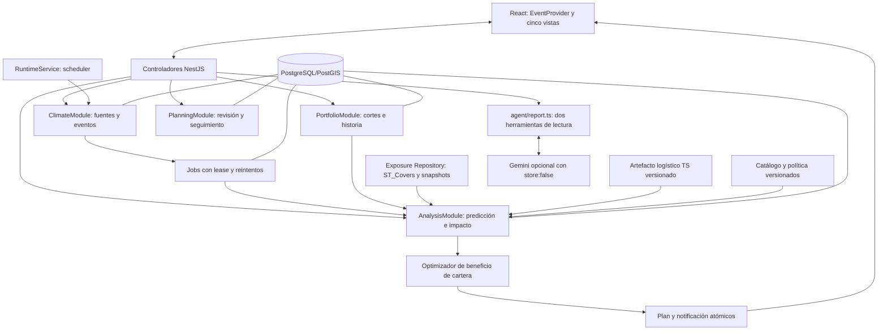
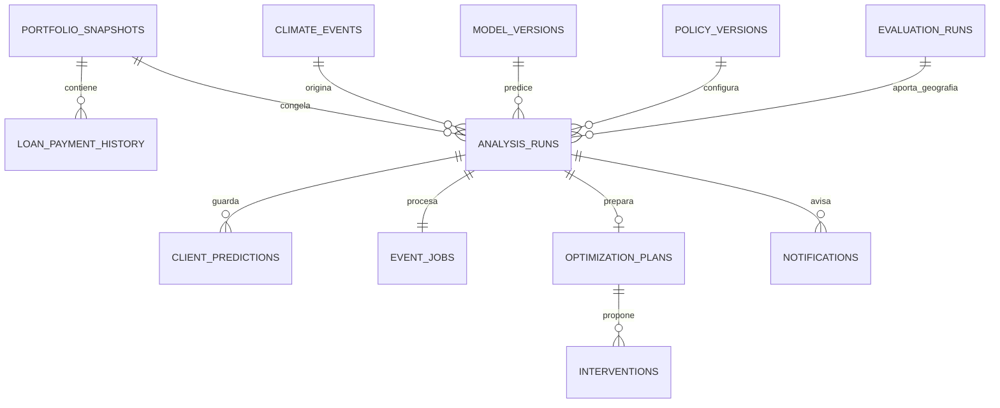

# Arquitectura actual de ClimaShield AI

Refactorización por eventos del 26/11/2026. Monolito modular **NestJS + TypeScript**, **React + Vite** y **PostgreSQL/PostGIS** en Docker. Supabase sigue siendo destino PostgreSQL configurable; no se verificó un despliegue remoto. Gemini se llama exclusivamente desde NestJS.

La [propuesta y comparación antes/actual](plan-refactorizacion-puntos-mejora.md) y el [informe de implementación](refactor-implementation.md) explican las eliminaciones y límites. La [arquitectura anterior](archive/architecture-20261124.md) y su [SVG histórico](architecture.svg) se conservan como evidencia previa.

## Responsabilidades y contratos

| Ubicación | Responsabilidad |
| --- | --- |
| `apps/api/src/main.ts` | Composición de módulos, errores, CORS y salud |
| `portfolio/` | Corte inmutable, perfiles sintéticos y 24 períodos por crédito |
| `climate/exposure.repository.ts` | SQL espacial, índice de referencia, fuentes y evaluaciones reproducibles |
| `climate/events.service.ts` | Identidad del aviso/revisión, snapshot, vigencia y replay rotulado |
| `analysis/model.ts` | Entrenamiento logístico, variables al corte, explicación, métricas y grupos |
| `analysis/impact.ts` | Escenarios pareados y calendarios financieros con Decimal |
| `analysis/analysis.service.ts` | Encolado, inferencia, finalización transaccional y consulta de evidencia |
| `analysis/runtime.service.ts` | Detección periódica, actualización del corte sintético y consumo de trabajos |
| `planning/` | Política inmutable, candidatos, optimización, comparadores, autorización y estados |
| `agent/report.ts` | Informe contextual; herramientas validadas, sin aprobaciones ni contactos |
| `shared/` | Contratos sin runtime, importes, autorización y estados |
| `apps/web/src/app/` | Montaje, navegación y contexto de evento; credencial en memoria |
| `apps/web/src/features/` | Eventos, cartera, impacto, planes y fuentes; vistas cargadas de forma diferida |

El repositorio espacial sigue concentrando las consultas geográficas y el índice histórico; ya no coordina los cálculos de crédito ni los planes. El simulador de caja antiguo permanece solo como referencia de regresión.

## Persistencia

Migraciones SQL versionadas, checksum y transacciones. Se conservan `0001–0003`; `202611260004_event_analysis.sql` añade:

- `portfolio_snapshots`, `loan_payment_history`, `model_versions`, `policy_versions`.
- `climate_events`, `analysis_runs`, `client_predictions`, `event_jobs`, `notifications`.
- `202611260005_financial_periods.sql` agrega `financial_projection_periods` con importes NUMERIC y totales NUMERIC en planes.
- Referencias `analysis_id` en planes y escenarios financieros anteriores.

Hay 23 tablas en el esquema, incluida `schema_migrations`. Los triggers protegen versiones/snapshots/eventos inmutables y las transiciones de intervención. RLS sigue habilitado sin acceso anónimo. El rol propietario de la demo requiere sustitución por privilegios mínimos y Auth antes de un piloto.

## Invariantes de cálculo y ejecución

- Ubicación ausente → `UNKNOWN`. Geocodificación cuestionable o datos insuficientes → revisión, sin predicción nueva.
- Índice climático ≠ probabilidad de atraso; exposición ≠ pérdida; beneficio modelado ≠ ahorro observado.
- `ST_Covers` incluye bordes. Préstamos agregados antes del cruce y resultados únicos por negocio; no se suman varias veces por capas.
- Decimal y NUMERIC para importes; el solver utiliza centavos enteros y BigInt para comparar beneficios sin perder precisión.
- Un modelo activo explícito, política, corte, evento y versión de motor identifican cada ejecución. El evento nunca se modifica para fingir una nueva versión.
- Un job se reclama con bloqueo breve y lease. El análisis se ejecuta fuera de transacciones largas; su salida y la notificación se confirman juntas y comprueban el token del lease.
- Un aviso actualizado produce otro evento; cambiar solo la hora de consulta no lo duplica. Repetir entradas no duplica ejecución, plan ni notificación.
- El cálculo y la alerta funcionan sin Gemini. El informe con IA requiere la solicitud autenticada del coordinador; fallos no cambian el informe previo por una respuesta falsamente atribuida a IA.

## Límites de despliegue

La cola está en PostgreSQL y el procesador comparte el proceso Node; un análisis puede bloquear temporalmente HTTP durante los cálculos. No se introduce infraestructura de concurrencia productiva. El mapa carga MapLibre solo al abrirse; tabla y detalle funcionan sin WebGL o teselas. El chunk de MapLibre conserva un aviso de tamaño del bundler.

La revisión mensual CENEPRED crea una tarea y permite registrar evidencia humana; no descubre automáticamente publicaciones nuevas. La actualización de historia produce nuevos datos sintéticos, no pagos reales. Sequía, otros segmentos, importación, canales externos, integración bancaria y Auth institucional siguen fuera del MVP.
