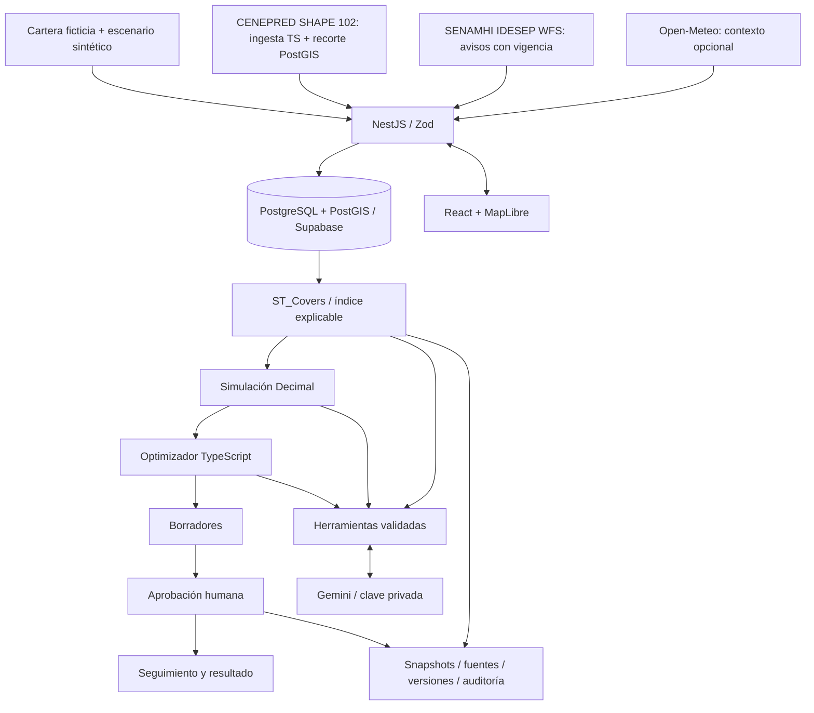
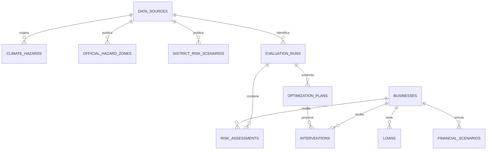

# Arquitectura ClimaShield AI

NestJS + React + PostgreSQL/PostGIS local en Docker; destino Supabase por .env. Gemini en backend. Diagrama exportable: [SVG](architecture.svg).

## Decisiones técnicas

- WGS84 SRID 4326, longitud/latitud. GiST en puntos/polígonos; ST_Covers incluye bordes.
- Fuentes oficiales en tablas propias (official_hazard_zones, district_risk_scenarios) con MultiPolygon, external_id, vigencia y synthetic=false; el escenario sintético queda en climate_hazards. Cada evaluación guarda hazard_source y versiones/checksums de fuentes.
- shapefile.ts lee .shp/.shx/.dbf por desplazamiento; official.ts concentra conectores, validación Zod de GeoJSON, cargadores idempotentes y política de actualización.
- Créditos activos agregados antes del cruce; prioridad máxima por negocio sin duplicar saldos.
- NUMERIC en PostgreSQL, Decimal.js en cálculo, strings para importes JSON.
- Evaluaciones guardan snapshot, evidencia por amenaza, versión y hash de entradas.
- FK, CHECK y unicidad run/negocio y plan/negocio. Trigger protege estados; aprobación y auditoría en una transacción con bloqueo de fila.
- Esquema privado climashield; RLS sin políticas anónimas. React accede por NestJS.
- MapLibre diferido; tabla equivalente accesible. Sin teselas, los vectores permanecen sobre fondo neutro.

El worker de MapLibre 6 se empaqueta con `?worker&url` y `setWorkerUrl`, siguiendo su [guía oficial para Vite](https://maplibre.org/maplibre-gl-js/docs/). Se probó también en el build servido por Nginx.

`controller.ts` coordina; `repository.ts` consulta/persiste; `domain.ts` contiene funciones puras; `agent.ts` controla SDK/tools; `database.ts` configura pg. Se evita crear capas vacías; separar módulos por funcionalidad al crecer.

El optimizador usa programación dinámica de opciones múltiples en TypeScript, con máximo de 6000 estados. Sin poda puede certificar OPTIMAL/INFEASIBLE; con poda informa FEASIBLE/UNKNOWN. No usa OR-Tools: se adaptó al stack Node solicitado.

Supabase Auth/Storage no están integrados. La compatibilidad actual es PostgreSQL remoto; variables reservadas no equivalen a funciones operativas. `financial_scenarios` referencia negocio; su unión a un evento versionado es parte de la adaptación futura.

