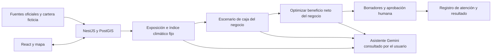
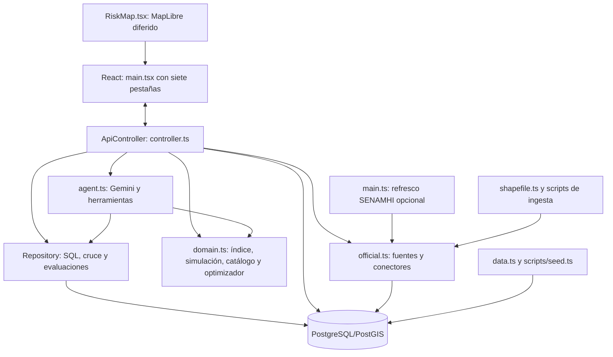
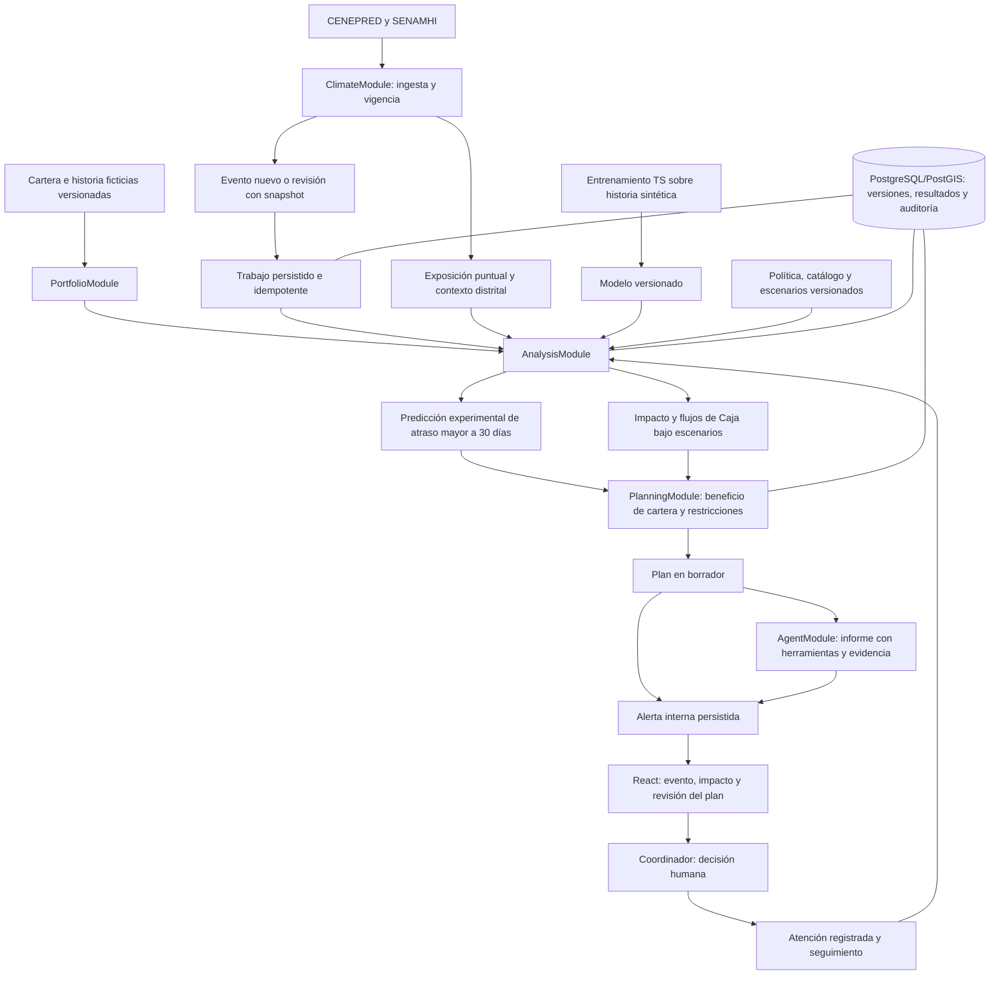

# ClimaShield AI: arquitectura y plan de refactorización

Fecha: **26 de noviembre de 2026, America/Lima**. Estado: **propuesta; no implementada**.

## 1. Decisión recomendada

Refactorizar el MVP para que su recorrido principal sea **evento climático → exposición → predicción experimental de deterioro → impacto financiero modelado → plan de facilidades → alerta interna → revisión humana → seguimiento**.

Se conserva NestJS + TypeScript, React + Vite y PostgreSQL/PostGIS. Se reutilizan la georreferenciación, las fuentes, la auditoría, las migraciones y el algoritmo de asignación. Se reemplazan las reglas que hoy determinan el valor del plan y se eliminan pantallas e integraciones que distraen de ese recorrido.

La prioridad es demostrar predicción, impacto y alerta con cartera ficticia. El chat, el mapa y el simulador dejan de ser productos independientes: pasan a apoyar una decisión por evento. No hace falta introducir microservicios, una API Python, SQLite ni otro proveedor de IA.

Este documento propone eliminaciones concretas, pero **esta entrega solo añade documentación: no borra módulos, datos ni funcionalidad**.

## 2. Evidencias y alcance de la comparación

La referencia de mejora es `C:/Users/JHARO/Downloads/ClimaShield_Puntos_de_Mejora.docx`, documento del 25/11/2026, secciones 2, 4 y 8. Sus propuestas se contrastaron con [README](../../README.md), [Solution Concept](../../SOLUTION_CONCEPT.md), [arquitectura](../architecture.md), [preexistentes](../preexisting-components.md), código, migraciones y pruebas.

Los tres estados se distinguen así:

| Estado | Qué representa | Evidencia |
| --- | --- | --- |
| Antes: concepción previa a las mejoras | Diseño de seis capas y flujo de prevención del 24/11 | Solution Concept y arquitectura existentes |
| Actual: implementación inspeccionada | Monolito funcional del commit `cd9303d`, con código concentrado en pocos archivos | `apps/api/src/`, `apps/web/src/`, migraciones 0001–0003 |
| Propuesto: después de refactorizar | Nuevo recorrido por evento, modelo, impacto y alertas | Diseño de este documento; todavía sin implementar |

**Límite histórico:** Git contiene `37530ef` (inicio, solo README) y `cd9303d` (MVP). No hay una versión ejecutable anterior intermedia que permita mostrar otra arquitectura técnica histórica. El diagrama de “antes” representa el concepto previo a las mejoras, no un sistema diferente del actual ni una supuesta API Python anterior.

Las atribuciones al expediente, FAQ, facilidades de la Caja y pérdida histórica del 10% proceden del Word. La [página pública del Cajathon](https://cajathon.cajatrujillo.com.pe/), consultada el 26/11, no permitió corroborar esos detalles: el contenido recuperado muestra RIE-01 sin el expediente completo. Por ello son insumos del documento adjunto, pendientes de contrastar con sus fuentes primarias. Los ejemplos numéricos del Word no son resultados del repositorio.

Hay dos correcciones al propio Word:

- El repo tiene seed, exportación y API REST, pero **no tiene importador de cartera CSV/Parquet**. La importación descrita en su sección 7 sería nueva; CSV sería suficiente para una primera versión.
- La falta de actualización no es total: existe refresco SENAMHI configurable. Falta activarlo de forma operativa, registrar ejecución y vincular novedades con eventos y alertas.

## 3. Arquitectura antes: concepto del 24/11



La pregunta central era: **¿qué negocios están expuestos y cómo repartir recursos de prevención?** El índice es explicativo y experimental. No hay modelo entrenado, estimación de deterioro futuro ni impacto en los estados financieros de la institución.

Las seis capas declaradas son fuentes, integración/datos, inteligencia climática, inteligencia financiera del negocio, asistente IA y aplicaciones. El evento operativo y las políticas versionadas ya figuraban como adaptación futura; no están construidos.

## 4. Arquitectura actual: cómo está organizado el código



| Componente real | Responsabilidad actual | Brecha o motivo de cambio |
| --- | --- | --- |
| `apps/api/src/main.ts` | Un `AppModule`; arranque, errores y temporizador SENAMHI | No hay trabajos persistidos ni ejecución por evento |
| `controller.ts` | Todas las rutas, autorización, cálculos y varias escrituras SQL | Mezcla HTTP, negocio y persistencia; dificulta reutilizar el flujo desde un job |
| `repository.ts` | Consulta de negocios, PostGIS, índice, snapshots y fuentes | Mezcla exposición, reglas de prioridad y persistencia |
| `domain.ts` | Índice, caja, catálogo de acciones, candidatos, optimizador y estados | El objetivo usa `net_benefit` del negocio; no usa pérdida de cartera |
| `official.ts` y `shapefile.ts` | CENEPRED, SENAMHI, validación y procedencia | Base reutilizable; frescura declarada no equivale a actualización verificada |
| `data.ts` | 1,000 negocios ficticios reproducibles | Sin historia de pagos ni segmentos crediticios; vulnerabilidad/adaptación pseudoaleatorias |
| `agent.ts` | Siete herramientas acotadas; consultas iniciadas por HTTP | No detecta eventos ni crea una bandeja de alertas |
| `apps/web/src/main.tsx` | Riesgo, negocios, simulador, intervenciones, IA, fuentes y arquitectura | Estado y vistas concentrados; navegación por herramientas aisladas |
| Migraciones 0001–0003 | 12 tablas de dominio y `schema_migrations` | Sin eventos operativos, modelo entrenado ni historial de pagos |

Hechos que deben conservarse: montos calculados con Decimal y guardados en NUMERIC; préstamos activos agregados antes del cruce; `ST_Covers` incluye bordes; sin ubicación, `UNKNOWN`; fuentes y versiones en las evaluaciones; aprobación auditada y protegida por trigger. Supabase es un destino PostgreSQL configurable: Auth/Storage e integración remota no están comprobados.

Hoy el aviso SENAMHI es una bandera: **no modifica el índice ni dispara un plan**. La evaluación mantiene un respaldo distrital cuando no hay zona puntual aplicable. El índice y las tres intensidades fijas no deben presentarse como predicción.

## 5. Arquitectura propuesta

Un **monolito modular NestJS** con una cola pequeña de trabajos en PostgreSQL. El procesador puede correr en el mismo despliegue local; no requiere Redis, Kafka ni un servicio ML separado. El entrenamiento sería un script TypeScript fuera del ciclo HTTP y la inferencia un servicio de NestJS.



La automatización detecta y prepara; Gemini explica los resultados mediante herramientas. **El código controla cuándo evaluar, qué calcular y qué estados cambiar.** El modelo generativo no necesita decidir si inicia un evento ni tener permisos de aprobación o contacto. Si Gemini falla, el plan y la alerta interna siguen disponibles con un informe determinista rotulado “sin IA”.

### Organización propuesta de archivos

```text
apps/api/src/
  main.ts                     # arranque
  app.module.ts
  portfolio/                  # negocios/clientes, créditos, cortes e historia
  climate/                    # fuentes, conectores, exposición y eventos
  analysis/                   # variables, modelo, escenarios e impacto
  planning/                   # candidatos, optimizador, facilidades y seguimiento
  agent/                      # Gemini, herramientas e informe por evento
  shared/                     # conexión, transacciones, Decimal, jobs y auditoría
apps/web/src/
  main.tsx                    # montaje de React
  app/                        # navegación y contexto del evento seleccionado
  features/events/            # eventos y alertas
  features/portfolio/         # lista, mapa y detalle del cliente
  features/impact/            # escenarios e impacto de cartera/Caja
  features/plans/             # revisión y seguimiento
  features/sources/           # procedencia y actualización
  shared/                     # API, tipos y componentes comunes
scripts/
  generate-credit-history.ts
  train-deterioration-model.ts
  evaluate-deterioration-model.ts
supabase/migrations/           # nuevas migraciones; 0001–0003 intactas
```

Son carpetas y módulos propuestos, no archivos existentes. Cada módulo tendrá controladores, servicios y consultas cuando necesite esas responsabilidades; no se crearán capas vacías. La API conservará el acceso exclusivo a PostgreSQL y Gemini.

## 6. Qué quitaría, reemplazaría y conservaría

| Elemento | Decisión | Cambio concreto y efecto |
| --- | --- | --- |
| Pestaña **Asistente IA** y consulta abierta `/agent/run` | Eliminar del producto principal | Sustituir por informe del evento y explicación contextual. Retirar la ruta cuando la nueva vista y sus pruebas la sustituyan; conservar el SDK y las herramientas útiles |
| Pestaña **Arquitectura** y componente `Architecture()` | Eliminar de la aplicación | La arquitectura queda en `docs/`; reduce una sección que no ayuda a resolver un evento |
| Open-Meteo y `/climate/live` | Eliminar | Quitar consulta desde React, ruta, registro y política propios; hoy solo da contexto y no alimenta decisiones. Conservar registros históricos y atribuciones existentes |
| Simulador libre con costo y eficacia arbitrarios | Retirar como pantalla independiente | Integrarlo al detalle del cliente con acción/política seleccionada. Separar caja del cliente e impacto de la institución |
| Constante `ACTIONS` y eficacia fija de llamada/inventario/liquidez | Reemplazar | Catálogo versionado de propuestas financieras y visitas justificadas; una acción financiera no reduce físicamente días de lluvia ni daño de inventario |
| Objetivo `net_benefit` del optimizador | Reemplazar | Maximizar reducción modelada de pérdida de cartera menos costos institucionales pertinentes, con beneficio del cliente como criterio secundario |
| FIFO como única comparación | Reemplazar en la demo | Referencias “mayor saldo” y “sector/zona” bajo iguales restricciones; conservar el caso FIFO solo si sigue siendo útil como prueba técnica |
| Índice fijo como principal prioridad de crédito | Retirar de esa función | Mantenerlo como referencia climática explicativa; predicción y prioridad operativa tendrán campos distintos |
| Selector global leve/moderado/severo y oficial/sintético | Mover a modo demo/técnico | La pantalla principal selecciona un evento y muestra su procedencia. Ningún escenario ficticio se mezcla silenciosamente con uno oficial |
| Vulnerabilidad y adaptación aleatorias como verdad crediticia | Reemplazar | Generador documentado de perfiles e historia temporal; conservar el fixture viejo solo para regresión técnica |
| Mapa, fuentes, lista de clientes y revisión humana | Conservar e integrar | Mismo contexto de evento; la tabla funciona aunque WebGL falle |
| `domain.ts`, `repository.ts`, `controller.ts` monolíticos | Descomponer | Mover lógica por dominio; eliminar los archivos antiguos solo cuando no queden consumidores |
| Seed anterior, resultados y documentos previos | Conservar como evidencia | No sobrescribirlos para hacer parecer que las capacidades nuevas ya existían |

No eliminaría el optimizador completo ni la georreferenciación. Lo incorrecto para el nuevo objetivo es la construcción de candidatos, la valoración de acciones y parte de las restricciones. El algoritmo de opciones múltiples se puede reutilizar si soporta los nuevos recursos y sus límites de búsqueda siguen explícitos.

## 7. Cambios funcionales y criterios técnicos

### 7.1 Cartera e historia sintéticas

Generar 24 meses de cronogramas, pagos, días de atraso y saldos por crédito, con cortes temporales reproducibles. Añadir segmento crediticio, deuda con otras entidades, liquidez y sensibilidad sectorial. Un cliente puede tener varios créditos: su identidad no se duplica al cruzar peligros.

Los perfiles se generan con relaciones documentadas, variación y semilla fija; no se asigna el resultado futuro con la misma fórmula exacta que luego aprenderá el modelo. Registrar que toda la historia de clientes y eventos pasados simulados es ficticia, incluso cuando se reutiliza cartografía real.

El primer caso completo será micro/pequeña empresa. El esquema admitirá los otros segmentos mencionados en el Word; un segmento sin modelo probado se mostrará como “cobertura no validada”, sin inventar desempeño. No se necesita importar cartera real para esta demostración.

### 7.2 Modelo predictivo separado del índice climático

Primera versión: **regresión logística regularizada en TypeScript**, con entrenamiento reproducible y coeficientes exportados. Es una alternativa más pequeña que incorporar LightGBM, otro runtime o una API Python. No se necesita SHAP para explicar esta primera versión: se pueden mostrar las contribuciones exactas de las variables al logit y aclarar su escala.

- Objetivo propuesto: cliente al día o con atraso ≤30 días al corte que entra en atraso **>30 días en alguno de los siguientes 90 días** del evento. Horizonte y unidad deben quedar versionados; los casos ya deteriorados se derivan por otra regla.
- Variables disponibles al corte: historia anterior, carga de cuotas, liquidez, sector, exposición puntual, contexto distrital y aviso vigente. No usar pagos futuros ni datos de la etiqueta como entrada.
- División de entrenamiento/validación/prueba por tiempo y eventos completos; impedir que las ventanas de resultados crucen los cortes. Reportar también una prueba con clientes no vistos para medir dependencia entre observaciones.
- Evaluar discriminación y calibración: PR-AUC, ROC-AUC, Brier, curva de calibración y precisión/recall con umbrales y tamaño de muestra visibles. Comparar contra tasa base y modelo sin variables climáticas.
- Guardar versión, hash del dataset, fecha de corte, variables, normalización, coeficientes, métricas y limitaciones. Activar una versión explícita, sin reentrenamiento automático que cambie la demo.

La salida se llamará `p_atraso_30d_90d`, **experimental y entrenada con datos sintéticos**. `climate_index` seguirá siendo un índice de exposición/vulnerabilidad, nunca una probabilidad de mora. Métricas altas en datos inventados validan la implementación y las reglas del generador; no demuestran capacidad predictiva sobre la Caja.

### 7.3 Impacto de cartera y estados financieros: tres salidas distintas

El Word propone `saldo × probabilidad de deterioro × severidad`. Es utilizable como aproximación de escenario si cada término se define, pero **atraso >30 días no equivale por sí solo a default y el 10% agregado de 2017 no identifica una severidad condicional**.

Para el prototipo se propone separar:

| Salida | Cálculo / contenido | Interpretación |
| --- | --- | --- |
| Exposición y deterioro | Saldo expuesto; `Σ(saldo × p_atraso_30d_90d)` | Saldo y saldo ponderado por deterioro; ninguno es pérdida |
| Pérdida modelada | `Σ(saldo × p_atraso_30d_90d × severidad_condicional_30d)` bajo una política de escenario | Aproximación experimental. La severidad es un supuesto sintético condicional al deterioro, no una LGD calibrada |
| Puente financiero de la Caja | Cobros de principal e intereses por período, cuotas diferidas, costos operativos, nuevas salidas de liquidez si existen, pérdida modelada y variación de margen | Escenario de tesorería y resultados; no estados financieros certificados ni provisiones regulatorias |

La simulación conservará los períodos y distinguirá **principal cobrado, ingreso por intereses, pérdida y gasto operativo**. Diferir principal afecta caja y calendario de cobro, no supone automáticamente un gasto por todo el importe. Una línea nueva aumenta desembolso y exposición; su principal no es simplemente un costo administrativo. No sumar otra vez una pérdida ya incorporada al mismo escenario.

Mostrar comparación sin plan/con plan y desglose por zona, sector y segmento. El dato del 10% solo se usaría como referencia agregada de sensibilidad una vez verificada su definición, población y horizonte; no como constante universal. No añadir un cálculo de “provisión que debe registrar la Caja” sin reglas contables, regulatorias y aprobación institucional verificadas.

Como contraste metodológico general, el [Comité de Basilea sobre pérdidas esperadas](https://www.bis.org/committees/bcbs/basel-consolidated-guidelines/module/pap/20) distingue el aumento de riesgo asociado al atraso de la medición de pérdidas; también advierte que una modificación puede ocultar deterioro. Esta referencia no establece qué norma contable o provisión concreta corresponde a Caja Trujillo.

### 7.4 Facilidades y optimización

Sustituir el catálogo por **propuestas sujetas a evaluación**: reprogramación de cuotas, evaluación de liquidez con visita y derivación a analista. Una línea de contingencia quedaría para una ampliación posterior, porque exige modelar elegibilidad, nueva exposición y fondeo. No se presentará una propuesta como “preaprobada” sin una aprobación institucional real.

Cada acción tendrá elegibilidad, calendario de cobro, costo para la Caja, costo para el cliente, minutos y supuestos de efecto versionados. Una reprogramación cambia las obligaciones y la caja; no reduce por sí sola el daño físico. Tampoco se dará por recuperado un cliente solo porque se desplazó su vencimiento: medir continuidad, recuperación y atrasos también respecto del calendario previo.

Definir por cliente y acción `beneficio_cartera = pérdida_modelada_sin_acción − pérdida_modelada_con_acción − costo_incremental_Caja`, evitando descontar un costo dos veces. El optimizador maximiza esa suma y usa el beneficio del cliente como desempate o restricción de protección, sin convertir el saldo completo en “pérdida evitada”.

Restricciones: una propuesta por cliente, elegibilidad, minutos de asesor, presupuesto operativo y cobertura mínima definida por política. Si se incorporan desembolsos, añadir un límite de liquidez separado del presupuesto operativo. Conservar resultados `OPTIMAL/FEASIBLE/INFEASIBLE/UNKNOWN` y no prometer óptimo si se poda la búsqueda.

**Límite causal:** cambiar una variable y volver a ejecutar el modelo no demuestra el efecto de una facilidad. La diferencia con/sin acción procederá de escenarios declarados del simulador; será beneficio hipotético. Su eficacia necesita evidencia futura. El entrenamiento sintético no resuelve esa validación.

### 7.5 Incertidumbre, clima y sesgos

Simular, por ejemplo, 500 escenarios por cliente con semilla, distribución y versión conocidas. Compartir la realización del evento entre clientes de una misma zona para conservar dependencia; reutilizar las mismas realizaciones al comparar acciones. Reportar media, percentiles y supuestos. Un rango entre escenarios no es automáticamente un intervalo de confianza estadístico del modelo.

Separar exposición **puntual**, **contexto distrital** y **aviso**. La tasa de población expuesta de un distrito no se transformará en certeza sobre un local. La ausencia de coincidencia puntual tampoco prueba seguridad; registrar cobertura cartográfica y resolución. Ubicación ausente sigue siendo `UNKNOWN`, no riesgo cero ni elegibilidad automática para una acción climática.

El clima debe aportar señal verificable en los datos sintéticos: comparar variables financieras solas frente a financieras + clima y mostrar pares de clientes comparables. No subir pesos hasta conseguir una demo atractiva. Si se conserva el índice como referencia, justificar pesos mediante una política documentada; el método de Saaty del Word requerirá la fuente, la matriz de comparaciones y su consistencia antes de afirmar que se aplicó.

Revisar calibración, errores, cobertura y asignación de acciones por zona, sector y segmento, con tamaños de muestra. Exponer limitaciones en grupos pequeños y concentración territorial. Ninguna revisión con datos ficticios certifica ausencia de sesgos reales; las alertas no deniegan créditos automáticamente.

### 7.6 Evento, actualización y alerta

El scheduler consulta SENAMHI a una frecuencia configurable —30 minutos como valor inicial propuesto, ajustable a vigencia y disponibilidad—. Un aviso nuevo o una revisión relevante crea evento y job; su clave combina fuente, identificador externo, versión y política. Repetir una consulta no duplica eventos, planes o alertas.

El job toma un snapshot del evento, cartera, cartografía, modelo y política; ejecuta análisis y plan; persiste resultados; crea la alerta interna para el coordinador. Guardar la alerta en PostgreSQL y mostrarla en la aplicación satisface el mecanismo de aviso del prototipo sin integrar correo, WhatsApp ni contactos reales.

Persistir estado, intentos, próxima ejecución y lease del job. Reclamarlo con bloqueo breve; hacer llamadas externas y cálculos fuera de transacciones largas. Finalizar resultados y notificación en una transacción idempotente. Tras reiniciar, recuperar trabajos pendientes o con lease vencido; los reintentos tienen límite y error visible. Gemini puede enriquecer el informe después, sin bloquear la alerta numérica.

La revisión mensual de fuentes y el corte mensual de cartera serán parte del mínimo, no un ajuste opcional al final. Para CENEPRED registrar la comprobación de versión y procesar un paquete solo si cambió. Si no hay un mecanismo fiable de detección automática, generar una tarea mensual y registrar evidencia de revisión humana; no afirmar que hubo actualización solo por ejecutar un temporizador.

Fuentes caídas, vacías y vencidas son estados diferentes. Un replay de un aviso vencido se identifica como demostración y nunca como alerta vigente. No se promete detectar a las 6:05 si el sistema consulta cada 30 minutos.

## 8. Persistencia y API

### Migraciones aditivas

Conservar `202611240001` a `202611240003` sin cambios. Añadir migraciones con identificadores nuevos, checksum y transacciones, sin reset ni sincronización automática. Esquema mínimo sugerido:

| Nueva entidad | Responsabilidad |
| --- | --- |
| `portfolio_snapshots` | Corte y procedencia de la cartera ficticia; manifiesto/hash de registros usados |
| `loan_payment_history` | Cronograma, pagos y atrasos por crédito y período |
| `climate_events` | Tipo, estado, aviso y revisión de origen; snapshot y vigencia |
| `policy_versions` | Catálogo, elegibilidad, hipótesis financieras, escenarios y reglas operativas inmutables |
| `model_versions` | Artefacto, entrenamiento, métricas y cobertura del modelo |
| `analysis_runs` | Unión de evento + cartera + modelo + política + semilla y estado de ejecución |
| `client_predictions` | Predicción por cliente y ejecución, variables al corte, explicación e impacto de escenario |
| `event_jobs` | Cola persistida, reintentos, lease e idempotencia |
| `notifications` | Alerta interna, referencia al plan, destinatario funcional y lectura |

Reutilizar `evaluation_runs`, `risk_assessments`, `financial_scenarios`, `optimization_plans`, `interventions` y `audit_events`, agregando referencias al análisis y campos necesarios. Los snapshots antiguos siguen siendo legibles, con su metodología y versión originales. Los importes nuevos usan NUMERIC y Decimal; los JSON preservan strings monetarios. Agregar unicidad de evento/revisión y de ejecución/cliente, y claves de idempotencia para plan/notificación.

El histórico de créditos permite pérdida por operación; el agregado final agrupa correctamente por cliente y suma cada crédito una sola vez. Al cruzar varias amenazas de un evento, calcular escenarios conjuntos o una regla explícita de combinación: nunca sumar dos veces el mismo saldo o la misma pérdida. Tampoco sumar eventos solapados como si fueran independientes.

### Contratos propuestos

| Ruta propuesta bajo `/api/v1` | Uso |
| --- | --- |
| `GET /events` y `GET /events/:id` | Bandeja y detalle del evento con procedencia |
| `POST /events/:id/analyses` | Reejecución controlada; devuelve job/ejecución, sin esperar todo el análisis en HTTP |
| `GET /analyses/:id` | Estado, exposición, versión de modelo e impacto |
| `GET /analyses/:id/clients/:clientId` | Explicación y escenarios del cliente |
| `POST /analyses/:id/plans` | Plan con política y restricciones explícitas |
| `GET /notifications` y `PATCH /notifications/:id/read` | Alertas internas y lectura |
| `GET /analyses/:id/report` | Informe Gemini o informe sin IA identificado |

Se mantienen negocios, fuentes, geometrías y seguimiento en lo que sea compatible. La autorización actual de coordinador se extiende a reejecuciones y cambios operativos; no se presenta como identidad institucional. La aprobación de una intervención sigue siendo una decisión humana y no equivale a ejecutar un contrato de crédito.

La retirada de rutas viejas ocurre después de migrar sus consumidores y pruebas. No hace falta conservar contratos de demo sin usuarios externos conocidos, pero sí sus resultados históricos. No se diseñará integración con un core, Databricks o Parquet sin una necesidad confirmada.

## 9. Trazabilidad con todos los puntos del Word

| Punto | Refactor propuesto | Prioridad / aceptación |
| --- | --- | --- |
| 1. Modelo predictivo | Historia temporal + regresión logística TS + registro de modelo | P0. Entrenamiento, evaluación separada y predicción reproducible; rótulo sintético |
| 2. Cartera y estados financieros | Impacto por cliente/crédito y puente de tesorería/resultados | P0. Separar exposición, deterioro, pérdida y caja; no mostrar provisión regulatoria |
| 3. Agente con alertas | Evento + job persistido + informe + notificación interna | P0. Un aviso nuevo produce un borrador y alerta sin pregunta del usuario; no aprueba ni contacta |
| 4. Objetivo del optimizador | Valor de cartera y costos institucionales | P0. Caso controlado donde una acción de menor ahorro comercial aporta mayor beneficio de cartera |
| 5. Facilidades | Catálogo versionado de propuestas financieras | P0. Elegibilidad, calendario y revisión humana; ninguna aprobación ficticia |
| 6. Muchos escenarios | Simulación reproducible y percentiles | P1. Misma semilla reproduce resultados; rangos bien identificados |
| 7. Cartera enriquecida | Pagos, endeudamiento, segmentos y sensibilidad sectorial | P0. 24 meses consistentes y variables disponibles al corte |
| 8. Peso del clima | Señales puntuales/distritales separadas y comparación de modelos | P1. Evidencia del aporte del clima y de la resolución, sin forzar pesos |
| 9. Sesgos | Reporte por grupos y explicación individual | P1. Errores, calibración, selección y tamaños de muestra visibles |
| 10. Segundo evento | Sequía agro como escenario ficticio explícito | P2. Reutilizar contrato de evento; fuente, geografía y variables propias. No reutilizar polígonos de inundación ni afirmar validación del modelo fuera de su cobertura |
| 11. Actualización mensual | Scheduler, ejecuciones registradas y revisión de versiones | P0. Fecha de última revisión, resultado y vencimiento; alertar si no se cumple |
| 12. Ajustes menores | Caso coherente, referencias alternativas, pesos documentados, límites y respaldo | P0/P1. Bodega usa acción real del catálogo; mayor saldo/sector-zona son referencias propuestas, no prácticas internas verificadas |

El escenario de sequía requiere ampliar o sustituir el recorte geográfico actual si se usa Chicama; no basta con cambiar una etiqueta. Si no hay tiempo, debe figurar como pendiente, y la cobertura del prototipo seguirá siendo parcial frente a todos los eventos mencionados.

## 10. Orden de ejecución y alcance recortado

| Paso | Trabajo | Resultado revisable |
| --- | --- | --- |
| 1. Preservar base | Registrar commit/etiqueta de corte, versión de datos y pruebas actuales | Base previa identificada; ningún historial sobrescrito |
| 2. Separar lógica necesaria | Extraer exposición, caja, candidatos y planificación de los archivos centrales | Los servicios pueden llamarse desde HTTP y jobs sin duplicación |
| 3. Datos y predicción | Migraciones aditivas, generador temporal, entrenamiento/evaluación TS | Modelo experimental y ficha de datos/modelo |
| 4. Impacto y facilidades | Calendarios por acción, impacto de Caja, nueva valoración y comparadores | Plan coherente con beneficio de cartera y costo institucional |
| 5. Evento y alertas | Scheduler, cola, idempotencia y bandeja interna | Aviso → análisis → plan → alerta sin consulta manual |
| 6. Simplificar React | Vistas por evento, explicación contextual y eliminación de secciones retiradas | Recorrido único con mapa/tabla y revisión humana |
| 7. Verificación y relato | Escenarios, sesgos, fuente fresca, caso Bodega, video y evidencias | Demo reproducible y límites explícitos |

No basta completar predicción e impacto y dejar alertas para un futuro indefinido: los tres forman el mínimo propuesto. Las prioridades P0 son de entrega, no una promesa de que cada cambio sea de esfuerzo bajo. Reordenar el plan del Word pone actualización operativa junto a alertas, porque estas dependen de datos vigentes.

**Recorte recomendado si el tiempo es limitado:** un caso completo de lluvias/inundación, cartera micro/pequeña ficticia, regresión logística, dos propuestas operativas —evaluación de reprogramación y visita de liquidez—, derivación de casos graves y notificación interna. Mantener contrato preparado para escenarios múltiples y construirlos en la siguiente iteración. Posponer segundo evento, línea de contingencia, importador genérico, Parquet, correo/WhatsApp, chatbot, Auth institucional y despliegue remoto. Mostrar esos pendientes como cobertura parcial, sin afirmar cumplimiento completo de capacidades aún ausentes.

## 11. Pruebas y criterios de cierre

Además de conservar las verificaciones actuales, los cambios futuros necesitan pruebas que cubran:

- Historia y etiqueta: cortes sin información futura, casos ya deteriorados separados y generación repetible.
- Modelo: artefacto verificable, normalización idéntica en entrenamiento/inferencia, probabilidades acotadas y evaluación temporal documentada.
- Geoespacial: borde incluido, ubicación ausente `UNKNOWN`, fuente sin cobertura, distinción puntual/distrital y no duplicación con varios créditos/peligros.
- Financiero: principal/interés separados, diferimiento sin falsa pérdida total, costo contabilizado una vez y escenarios sin/con acción comparables.
- Plan: restricción de una acción, elegibilidad, presupuesto/minutos, ejemplo ferretería/bodega y referencias bajo recursos equivalentes.
- Automatización: mismo aviso dos veces, revisión del aviso, caída del proveedor, reinicio del procesador y alerta/plan sin duplicados.
- Supervisión: ninguna herramienta Gemini aprueba o contacta; credencial ausente rechazada; auditoría y trigger conservados.
- Recorrido: aviso de prueba → evento → análisis → impacto → borrador → notificación → revisión humana → seguimiento; tabla usable si falla el mapa y datos precargados si no hay red.

Ejecutar `npm test` y `npm run build`; con PostgreSQL disponible, `npm run test:integration` y `npm run test:e2e`. No consumir Gemini real para pruebas automáticas ni confundir cliente controlado con proveedor real. Guardar métricas, capturas y límites en [validation-report.md](../validation-report.md).

**Verificación de esta entrega documental, 26/11/2026:** 12 pruebas unitarias aprobadas; build API/web aprobado. Vite conserva el aviso de chunk grande de MapLibre. Docker Desktop no tenía motor Linux accesible y la conexión PostgreSQL configurada respondió `ECONNREFUSED`; no se ejecutaron integración ni e2e. Estos resultados corresponden al código actual, no validan las capacidades propuestas. Detalle en el anexo del reporte.

## 12. Declaración de preexistentes y límites de la propuesta

Todo el código actual del commit `cd9303d`, incluidas fuentes oficiales, mapa, índice, simulador, optimizador, Gemini, bandeja y auditoría, es **previo a la fase presencial**. Esta propuesta del 26/11 también es preparación previa, no una funcionalidad ya construida.

Predicción, historia de pagos, impacto institucional, catálogo financiero, jobs, eventos y alertas son cambios nuevos **propuestos**. Se registrarán como implementados solo al existir código y pruebas; si se desarrollan antes del presencial, también pasan a ser preexistentes. Si se construyen durante el presencial, registrar commit inicial, cambios y evidencia de esas jornadas.

El Word ayuda a orientar el alcance, pero sus ejemplos y sugerencias no autorizan automáticamente contactos, desembolsos, contratos o aprobaciones. La demostración usa cartera y comportamiento ficticios; no acredita ahorro observado, eficacia causal, ausencia de sesgos reales ni calibración institucional. La sección de límites del pitch se puede unificar, manteniendo junto a cada resultado los rótulos esenciales: **sintético, experimental, modelado, vencido o sin IA**, según corresponda.

La demo debe incluir datos precargados, tabla alternativa al mapa y video de respaldo. Esa evidencia se identifica como grabación/snapshot, sin simular que el sistema está conectado en vivo.
