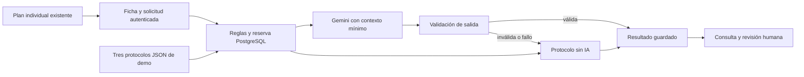

# MVP: acciones preventivas bajo solicitud

Implementado el **27/11/2026**, con datos exclusivamente sintéticos. Es una adaptación nueva respecto del corte del 26/11 y sigue siendo material previo a la fase presencial. La [arquitectura de generación por grupos](propuesta-redaccion-preventiva.md) continúa siendo el objetivo posterior.

## Qué se implementó

En Clientes, la ficha incorpora **Acciones preventivas**. La evaluación individual y el optimizador siguen funcionando mediante código. Después del plan, un coordinador puede preparar una secuencia de cuatro pasos para una atención seleccionada. Puede utilizar Gemini o solicitar expresamente el protocolo sin IA.

La pantalla muestra la acción del plan, la liquidez central calculada por el motor, los pasos ordenados, responsables, precauciones, fuentes, protocolo y procedencia. No inventa una brecha monetaria: el motor actual entrega percentiles de liquidez y frecuencia de brecha, no un importe observado de afectación. Nombres y valores se presentan desde el contexto guardado; no se envían al proveedor para que los recalcule.

Los tres protocolos están en [prevention-demo-1.json](../data/knowledge/prevention-demo-1.json): comprobación previa, evaluación de liquidez y evaluación de una propuesta de reprogramación. Son procedimientos ficticios sin aprobación institucional; no se atribuyen a una política de Caja Trujillo ni se presentan como normativa oficial. Los pasos desarrollan la atención ya presupuestada y no añaden visitas o facilidades.

## Caso de uso en la aplicación

1. Abrir un evento con análisis completado. Si es REPLAY o SYNTHETIC, conservar su identificación de demostración.
2. Entrar a **Clientes** y activar **Solo seleccionados en el plan**.
3. Elegir un cliente de prioridad alta seleccionado. Si el plan no incluye ninguno de prioridad alta, puede elegirse otro de los seleccionados, registrando un motivo de al menos diez caracteres. No se cambia su prioridad para habilitarlo.
4. Abrir **Coordinador** e introducir la credencial local, que permanece en memoria del navegador.
5. Pulsar **Preparar acciones preventivas**. Si existe clave, se intenta una única generación acotada. **Usar protocolo sin IA** permite preparar el respaldo sin llamar al proveedor.
6. Leer los cuatro pasos y contrastar los datos. Por ejemplo, para una visita de liquidez: comprobar seguridad, verificar continuidad, contrastar liquidez y registrar hallazgos.
7. Revisar la propuesta financiera y registrar el seguimiento en el flujo existente de intervenciones. Preparar la guía no aprueba, asigna ni registra contactos.
8. Volver a abrir la ficha: se consulta la misma recomendación guardada, sin generar nuevamente.

Ejemplo ficticio: un comercio seleccionado para visita muestra su liquidez central calculada y recibe instrucciones para contrastar ingresos/gastos y documentar la evaluación. Gemini redacta el campo de instrucción de cada paso. Los IDs, orden, títulos, fuentes, responsables y advertencias los fija el backend. La redacción se presenta como borrador pendiente de revisión humana.

No se garantiza que un negocio concreto como Bodega Horizonte esté incluido: depende de los datos y restricciones del análisis. Los clientes de prioridad alta que queden fuera del plan conservan su evaluación; un aviso en la ficha recuerda al coordinador revisar esa cobertura.

## Reglas y límites efectivos

- Máximo **cinco reservas nuevas por análisis**, impuestas con bloqueo de fila y `UNIQUE(analysis_id,slot)` con slots del uno al cinco. Tanto Gemini como un protocolo sin IA ocupan un lugar. Las consultas posteriores no ocupan otro.
- Prioridad alta según la política sintética del análisis, cliente seleccionado, estado PREDICTED, ubicación disponible y dentro del evento. Un plan sin factibilidad o un aviso LIVE vencido no habilitan una preparación nueva.
- No se habilita redacción para UNKNOWN, datos incompletos, fuera del evento ni casos ya deteriorados. Las propuestas fuera del plan no consumen generación.
- Identidad por análisis, cliente, plan/contexto, hash de protocolos, versión del redactor y modelo/configuración. Una versión diferente puede requerir otra reserva dentro del mismo límite de cinco. El historial anterior permanece en PostgreSQL.
- Una llamada al proveedor por reserva, sin reintentos automáticos del SDK; timeout de 20 segundos y hasta 1,600 tokens de salida. Modelo desde `GEMINI_MODEL`, sin cambiar la configuración existente.
- Máximo diario local de intentos configurado mediante `PREVENTION_DAILY_LIMIT` (20 por defecto, de 1 a 100), contado en fecha de Lima; separación mínima de 15 segundos entre reservas con proveedor. El límite diario agotado usa respaldo; el intervalo devuelve 429 sin reservar otro lugar. No son las cuotas de Google ni se comparten con el informe global existente.
- Al abrir o recargar solo se hacen lecturas. Una solicitud en curso se consulta cada dos segundos; si queda interrumpida más de un minuto, un nuevo clic recupera el protocolo sin volver a llamar a Gemini. La reserva y el intento incierto se conservan.
- El resultado guardado es inmutable. Un respaldo sin IA también queda guardado y no se convierte silenciosamente en una respuesta de Gemini mediante otro clic. No hay regeneración ilimitada ni edición del texto en esta entrega.

## Integración y trazabilidad

Componentes: `recommendations/`, `agent/prevention-writer.ts` y `features/portfolio/PreventionPanel.tsx`. `agent/report.ts` conserva el informe global independiente. No se implementan aún plantillas por grupo, lote masivo o worker nuevo; la solicitud de esta versión espera una respuesta acotada de NestJS, fuera de una transacción larga de base de datos.

Rutas bajo `/api/v1`:

| Método | Ruta | Función |
| --- | --- | --- |
| GET | `/analyses/:id/clients/:clientId/prevention` | Elegibilidad, cupos, hash y recomendación guardada, sin generación |
| POST | `/analyses/:id/clients/:clientId/prevention` | Preparar o reutilizar; requiere `X-Coordinator-Token` |

POST acepta únicamente `use_ai` (booleano; true por defecto) y `manual_reason` (texto de hasta 300 caracteres). La elegibilidad y la acción no se toman del navegador.

Migración nueva: `202611270006_preventive_recommendations.sql`. Añade una tabla con RLS, referencias a predicciones/plan, snapshots, reserva, lease, modo, uso reportado y contenido. Los triggers conservan contexto y resultado final; la auditoría existente registra solicitud, finalización y recuperación. No se modificaron las cinco migraciones anteriores.

Gemini recibe sector, modo del evento, prioridad, señal cualitativa de liquidez y pasos aplicables. No recibe nombres, saldos, documentos ni teléfonos. Usa el SDK oficial, `store:false`, salida JSON y ninguna herramienta para escribir, aprobar o contactar. El backend rechaza IDs/orden distintos, campos adicionales, instrucciones con cifras, enlaces, variables de plantilla o ciertas afirmaciones financieras prohibidas. Las fuentes y precauciones no son modificables por el modelo.

Estas comprobaciones no prueban corrección semántica ni reemplazan la revisión humana. El uso reportado se guarda incluso si el JSON es inválido; si el proveedor falla sin reportarlo, queda desconocido. No se afirma costo cero para un intento incierto ni se calcula una factura real a partir de la disponibilidad de una clave gratuita.

## Pendiente después del MVP

Revisión formal de protocolos, aprobación institucional, comparación de calidad con generación determinista, revisión textual versionada, reglas por fase/sector más detalladas, plantillas compartidas, colas de redacción y políticas de presupuesto monetario. La capacidad de la API gratuita se debe verificar en el proyecto del proveedor. El motor y el optimizador actuales no acreditan escala de cientos de miles de clientes.

Resultados reales y limitaciones de esta entrega: [informe de validación](validation-report.md). Las pruebas usan cliente Gemini controlado y protocolo explícito sin IA; no equivalen a un piloto con cartera real ni a una medición de calidad o cuota del proveedor.

Comprobación adicional real: se preparó y guardó la recomendación de **CS-0810, Agricultura demo 0810**, seleccionado con prioridad alta en el análisis de demostración. Gemini devolvió cuatro pasos válidos y reportó 495 tokens de entrada y 178 de salida. Es una sola muestra sintética, sin comparación de calidad; la respuesta conservó las instrucciones de los protocolos. El caso muestra una de cinco reservas utilizadas y se consultó posteriormente en navegador sin un nuevo POST. [Evidencia de la llamada](../artifacts/prevention-smoke.json) y [captura de la ficha con Gemini](mockup-prevention-gemini.png). Las [capturas sin IA](mockup-prevention.png) y [móvil](mockup-prevention-mobile.png) corresponden al fixture separado de las pruebas.
