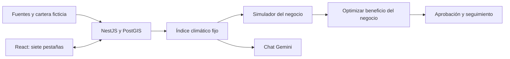
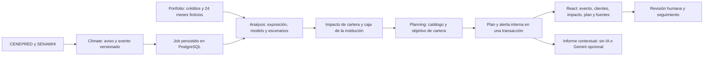

# ClimaShield AI: refactorización según los puntos de mejora

Actualizado el **26/11/2026, America/Lima**. Estado: **implementado localmente sobre el alcance recortado del plan**.

La propuesta original se conserva en [el archivo del plan](archive/plan-refactorizacion-20261126-propuesta.md). El detalle de cambios, eliminaciones, cobertura de los 12 puntos y pendientes está en [el informe de implementación](refactor-implementation.md). No se realizaron push ni despliegues.

## Arquitectura antes

Concepto del 24/11 y MVP `cd9303d`: exposición e índice fijo → simulación del negocio → optimización de su beneficio → borradores y seguimiento. El usuario iniciaba las evaluaciones y consultas Gemini.

## Arquitectura actual

La organización física, responsabilidades y persistencia se documentan en [architecture.md](architecture.md). El stack se conserva: NestJS/TypeScript, React/Vite y PostgreSQL/PostGIS; Gemini solo desde backend.

## Cambios realizados

| Acción | Resultado |
| --- | --- |
| Separar responsabilidades | Módulos de cartera, clima, análisis y planificación; informe en `agent/`; React por funcionalidad con contexto de evento |
| Añadir predicción | Regresión logística TS reproducible de atraso >30 días en 90 días; entrenamiento y evaluación sintéticos |
| Añadir impacto institucional | Pérdida modelada separada del saldo expuesto y calendario de cobros/costos, sin provisión regulatoria |
| Cambiar optimización | Beneficio neto de cartera, comparadores mayor saldo/sector-zona y alivio del cliente como desempate |
| Automatizar preparación | Eventos inmutables, cola con reintentos/lease, plan y notificación interna idempotentes |
| Cambiar catálogo | Evaluación de reprogramación de dos cuotas y visita de liquidez; nunca preaprobaciones automáticas |
| Simplificar interfaz | Cinco vistas por evento; mapa opcional, tabla y explicación accesibles |
| Retirar funcionalidad | Chat abierto, pantalla de arquitectura, simulador libre, Open-Meteo y rutas antiguas sin evento |
| Conservar evidencia | Migraciones 0001–0003 intactas, snapshots anteriores y documentos previos archivados |

## Qué sigue pendiente

Segundo tipo de evento y otros segmentos validados, líneas de contingencia, importador de cartera, detección automática de revisiones CENEPRED, Auth institucional, integraciones externas y Supabase remoto. La aplicación no utiliza datos de clientes reales ni acredita eficacia causal o calibración institucional.

Todos los componentes desarrollados el 26/11 siguen siendo **previos al presencial**. La [validación](validation-report.md) distingue los resultados actuales de las evidencias históricas.
