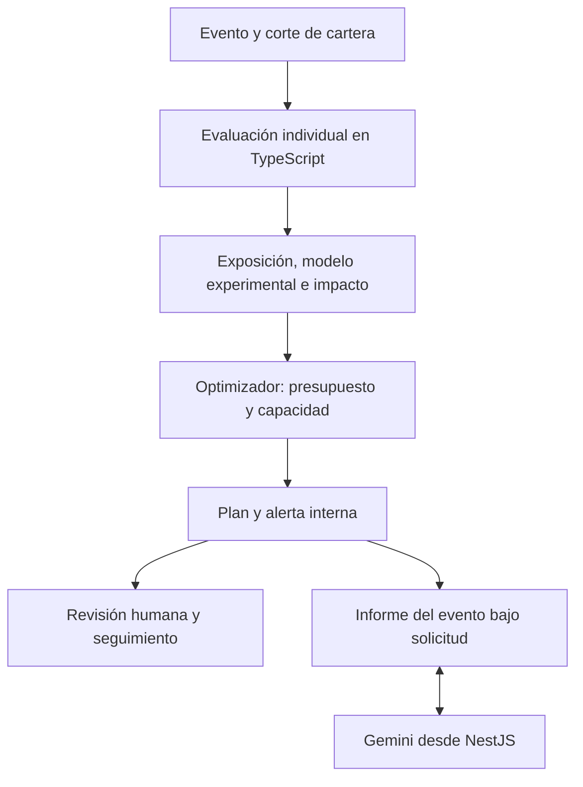
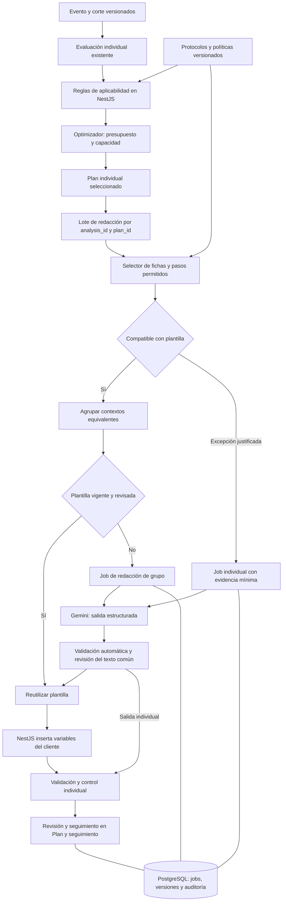

# Propuesta: acciones preventivas con redacción reutilizable

**Fecha:** 26/11/2026, America/Lima. **Estado:** propuesta de ampliación, sin implementación funcional en este cambio.

**Actualización del 27/11:** se implementó un [MVP individual acotado](mvp-prevencion.md) con tres protocolos demo, solicitud manual, cinco reservas por análisis, contexto mínimo para Gemini y resultados guardados. Las secciones siguientes conservan la arquitectura objetivo; agrupación, plantillas compartidas, lotes, worker y benchmark de 100 casos siguen pendientes.

## Decisión propuesta

Ampliar ClimaShield para preparar una secuencia de acciones preventivas por cliente seleccionado en el plan. NestJS calcula y decide la elegibilidad mediante reglas explícitas; Gemini redacta plantillas por grupos compatibles; NestJS completa los datos individuales. Las excepciones pueden solicitar una redacción individual acotada y siempre revisable.

La unidad de evaluación continúa siendo el cliente. La agrupación solo permite reutilizar redacción. Ni compartir plantilla ni recibir un texto implica aprobación de una facilidad financiera.

La primera entrega utilizará exclusivamente datos sintéticos, lluvias/inundación y los tipos de propuesta ya existentes: evaluación de reprogramación y visita de evaluación de liquidez. Los protocolos de demostración no se presentarán como políticas aprobadas por Caja Trujillo.

## Arquitectura actual comprobada



El código actual incluye `portfolio/`, `climate/`, `analysis/` y `planning/`. `agent/report.ts` genera opcionalmente un informe del evento mediante dos herramientas de lectura. No existe todavía una base de protocolos preventivos, agrupación de redacción, plantillas generadas ni recomendaciones individuales materializadas.

La evaluación, el optimizador, la cola PostgreSQL, el informe, las cinco vistas y el seguimiento son componentes previos a la fase presencial. Esta propuesta tampoco acredita una implementación ni un piloto.

## Arquitectura propuesta



Se mantiene el monolito modular NestJS. La cola continúa en PostgreSQL. La nueva redacción se procesa en un proceso worker separado de HTTP, compartiendo código y base de datos; así las llamadas y reintentos no retienen una solicitud del navegador. Esto no resuelve por sí solo el bloqueo del cálculo financiero actual: separar ese cálculo y acreditar capacidad a gran escala queda como trabajo adicional medible.

El flujo inicial será solicitado por un coordinador sobre un plan completado. No se generarán textos al abrir una página. La automatización posterior podrá activar el mismo lote idempotente cuando exista un plan, con límites de gasto configurados.

## Responsabilidades

| Componente | Reutilización o cambio propuesto |
| --- | --- |
| `portfolio/`, `climate/`, `analysis/impact.ts`, `analysis/model.ts` | Reutilizar evaluación individual, snapshots y cálculos con Decimal |
| `planning/` | Mantener selección individual; incorporar aplicabilidad de protocolos antes de optimizar cuando afecte a la acción |
| `knowledge/` nuevo | Cargar y validar fichas, fuentes, condiciones, vigencia y versión; devolver solo contenido aplicable |
| `recommendations/` nuevo | Crear lotes, formar grupos, detectar excepciones, insertar variables, validar y persistir recomendaciones |
| `agent/prevention-writer.ts` nuevo | Adaptador de Gemini para redacción estructurada con contexto acotado y `store:false` |
| `agent/report.ts` actual | Conservar el informe global del evento como función distinta de las recomendaciones |
| Worker nuevo | Reclamar jobs con lease, límites de concurrencia, reintentos y presupuesto |
| Vista Plan y seguimiento | Mostrar secuencia, origen, versión, pendientes y revisión sin añadir un chat abierto |

Los nombres de archivos y rutas de esta propuesta son objetivos de implementación, no componentes disponibles hoy.

## Base de conocimientos

Para el MVP, redactar fichas JSON versionadas en `data/knowledge/` y validarlas con Zod. Al publicar una versión, registrar en PostgreSQL su contenido congelado, hash y procedencia. Los trabajos referenciarán ese snapshot, no el archivo mutable del directorio de trabajo.

Cada ficha contendrá:

- Identificador y versión; estado `DEMO` o aprobación institucional documentada; fecha de revisión, vigencia y responsable.
- Amenaza, sector, fase del evento, idioma, audiencia y ámbito geográfico aplicables.
- Tipo de acción del catálogo operativo y condiciones verificables de inclusión o exclusión.
- Pasos permitidos y su orden, responsable de cada paso, precauciones y condiciones para detener o derivar.
- Variables autorizadas, campos obligatorios y comportamiento ante datos ausentes.
- Afirmaciones permitidas, prohibiciones y referencias a fuentes con título, fecha y evidencia conservada.
- Política financiera relacionada, si corresponde; ausencia de política significa pendiente de evaluación, nunca autorización implícita.

Separar tres contenidos: recomendaciones oficiales de prevención, procedimientos operativos de demostración y políticas financieras institucionales. Un caso extranjero aporta referencia, no habilita condiciones crediticias en Perú.

La selección inicial será por filtros y reglas sobre JSON/SQL parametrizado. No requiere embeddings ni base vectorial. Cuando se recuperan fichas relevantes para incorporarlas al contexto de generación, el patrón es una forma de RAG con recuperación estructurada.

Los pasos de preparación y seguimiento se vincularán a las acciones del plan. Si agregan esfuerzo o costo respecto de la política actual, se deberá versionar esa política y recalcular el plan antes de redactar. No añadir atenciones ilimitadas fuera de la capacidad presupuestada.

## Agrupación y reutilización

Una clave de grupo incluirá como mínimo: amenaza, fase, sector, idioma, audiencia, jurisdicción, perfil de restricciones, conjunto **y orden** de pasos permitidos, acción elegida, versión/hash del protocolo y de la política, versión del esquema de salida y del prompt, y modelo/configuración de generación.

La plantilla debe ser válida para todos los integrantes. Si un dato cambia las instrucciones —por ejemplo, operación suspendida, acceso inseguro o restricción específica— se añade una condición al grupo o se trata como excepción. Si solo cambia una variable autorizada —nombre, fecha o importe calculado— se mantiene el grupo.

La clave se construirá con serialización canónica y hash. La base impondrá unicidad para evitar dos plantillas simultáneas equivalentes. La clave de recomendación añadirá análisis, plan, cliente y hash del contexto individual. El mismo cliente puede pertenecer a grupos distintos en eventos distintos.

La reutilización entre eventos solo se permitirá para textos sin hechos propios del evento y con contexto compatible. Los avisos, las fechas, la vigencia y las condiciones se vuelven a comprobar al materializar cada recomendación. Una revisión, revocación o incompatibilidad impide nuevas reutilizaciones; se conserva la versión histórica usada.

## Contrato de redacción

Gemini recibe las fichas seleccionadas, IDs de pasos permitidos, campos variables autorizados y reglas de estilo. Para una plantilla de grupo no recibe nombres, documentos, teléfonos ni saldos individuales. Para una excepción recibe exclusivamente la evidencia sintética necesaria y un identificador opaco.

La salida será JSON validado, con estructura equivalente a:

```json
{
  "protocol_version": "prevencion-demo-1",
  "audience": "ASESOR",
  "steps": [
    {
      "action_id": "VERIFY_OPERATION",
      "order": 1,
      "owner": "ASESOR",
      "text": "Verificar con {{client_name}} la continuidad de su negocio para el evento {{event_label}}.",
      "source_ids": ["DEMO-OPS-001"]
    },
    {
      "action_id": "REVIEW_LIQUIDITY",
      "order": 2,
      "owner": "ASESOR",
      "text": "Revisar la brecha de caja modelada de {{cash_gap_pen}} y registrar datos pendientes antes de evaluar medidas.",
      "source_ids": ["DEMO-FIN-001"]
    }
  ],
  "required_variables": ["client_name", "event_label", "cash_gap_pen"],
  "requires_case_review": true
}
```

Ejemplo de demostración, no política financiera real. Los IDs definitivos se fijarán en las fichas. El backend determina pasos, orden, responsables y fuentes; el LLM debe devolver exactamente esos valores, redactando únicamente los campos autorizados.

NestJS rechazará IDs desconocidos, pasos extra/omitidos, cambios de orden, fuentes ajenas al contexto y variables no autorizadas o sin resolver. Los importes y fechas se insertarán con formato controlado, sin ejecutar expresiones de plantilla ni aceptar HTML generado. Datos obligatorios ausentes producirán `NEEDS_DATA`, no valores inventados.

Validar el JSON no demuestra corrección semántica. El texto común requerirá revisión humana antes de reutilizarse; los casos financieros o excepcionales conservarán revisión individual. No se afirmarán eficacias causales, facilidades aprobadas ni certezas sobre daños. El catálogo incluirá una plantilla determinista de respaldo identificada como **sin IA**, únicamente cuando los pasos aplicables estén completos y autorizados para la demo.

## Excepciones y revisión

La redacción individual se habilitará por incompatibilidad con los grupos existentes, necesidad de explicar condiciones admitidas o solicitud expresa del asesor con motivo registrado. Un dato crítico ausente, contradicción de fuentes o falta de política no se resuelve con más generación: se deriva a revisión o se pide completar datos.

Revisar una plantilla permite reutilizar su redacción común; no aprueba las decisiones de todos sus destinatarios. Antes de marcar cada recomendación lista, el backend vuelve a comprobar su contexto y la vigencia de referencias. Las propuestas financieras siguen las autorizaciones y estados existentes de intervención.

Registrar autor/revisor, fecha, motivo y versión en cada cambio. Una modificación humana crea una nueva revisión trazable. Un protocolo revocado impide usar recomendaciones pendientes basadas en él y exige revisión para sustituirlas. Una generación fallida no elimina el plan ni una recomendación previa revisada; una generación nueva tampoco sobrescribe silenciosamente esa revisión.

## Persistencia y API propuestas

Agregar una migración SQL nueva posterior a `202611260005`; no modificar las aplicadas. El diseño físico se cerrará al implementar, manteniendo estas entidades:

| Entidad propuesta | Información principal |
| --- | --- |
| `knowledge_versions` | Snapshot, hash, procedencia, vigencia y estado de disponibilidad; contenido publicado inmutable y cambios de estado auditados |
| `writing_batches` | Análisis/plan, versión de conocimientos, estado y límites de gasto |
| `writing_jobs` | Tipo grupo/individual, clave única, lease/token, intentos, próximo intento y error clasificado |
| `writing_templates` | Grupo, salida estructurada inmutable, hashes, proveedor/configuración y estado de revisión |
| `client_recommendations` | Cliente, análisis/plan, plantilla o excepción, contexto, salida materializada y revisiones |
| `writing_reviews` | Objeto y versión revisados, actor, decisión y motivo; historial append-only |
| `llm_usage_events` | Cada intento: tokens reportados, modelo, latencia, resultado y estimación de costo con tarifa versionada |

Usar claves foráneas y restricciones de unicidad. La revisión tendrá un objeto referenciado inequívoco, no un ID sin integridad referencial. Separar el contenido congelado de sus estados operativos cuando corresponda. Mantener RLS y acceso exclusivamente desde NestJS.

Rutas propuestas bajo `/api/v1`:

- `POST /analyses/:id/recommendation-batches`: solicitar preparación para los clientes seleccionados del plan; devolver `202`, ID y estado.
- `GET /recommendation-batches/:id`: progreso, grupos, bloqueos, uso y pendientes de revisión.
- `GET /analyses/:id/clients/:clientId/recommendation`: consultar la revisión aplicable y su procedencia.
- `POST /analyses/:id/clients/:clientId/recommendation-exceptions`: solicitar excepción con motivo y evidencia admitida.
- `POST /writing-templates/:id/reviews` y `POST /recommendations/:id/reviews`: registrar revisión de una versión concreta, con control de concurrencia.

Las escrituras exigirán la autorización local existente. Auth y roles institucionales continúan siendo condición de un piloto real. Los endpoints de redacción no aprobarán intervenciones ni contactarán clientes.

## Costos, recuperación y medición

El presupuesto de redacción será independiente del presupuesto operativo del optimizador. Definir máximos por lote de llamadas, tokens de entrada/salida, excepciones y gasto estimado; concurrencia limitada, timeout y hasta tres intentos totales para fallos transitorios. Rechazos por contenido o datos no generarán reintentos ilimitados.

Reservar presupuesto de forma atómica antes de cada intento y conciliarlo con el consumo reportado. Persistir también intentos fallidos y reintentos. Un timeout con consumo incierto queda como tal, con reserva conservadora; no se contabiliza automáticamente como costo cero. La cola evita resultados duplicados, pero no puede garantizar facturación exactamente una vez tras un fallo entre la respuesta del proveedor y el guardado local.

Estimación base:

```text
llamadas previstas = grupos nuevos + excepciones + reintentos
costo de tokens = suma por intento de tokens facturables × tarifa versionada
costo total = tokens + infraestructura + operación y revisión
```

El escenario anterior de 22,000 afectados, 50 plantillas y 2,200 excepciones supone que todos requieren un texto. Con la selección previa, el volumen inicial debe ser el número efectivamente atendible; el 10% de excepciones es una hipótesis, no una cuota obligatoria. Clientes no seleccionados mantienen evaluación y motivo de no atención, sin consumir generación individual. Deben existir métricas de cobertura para detectar necesidades urgentes que la capacidad no permite atender y derivarlas al coordinador.

Medir grupos reales, tamaño de grupo, reutilización, excepciones por motivo, tokens por intento, fallos, tiempo de revisión, correcciones y costo por recomendación lista. Una llamada puede devolver una salida inválida: no equivale a una recomendación utilizable. Las cifras monetarias ilustrativas de la conversación no son un presupuesto aprobado ni una medición del producto.

## Fases y criterios de aceptación

| Fase | Entrega | Criterio de aceptación |
| --- | --- | --- |
| 1. Protocolos y contrato | Fichas demo para lluvias/inundación, esquema Zod, selección por reglas y respaldo determinista | Cada paso tiene fuente, aplicabilidad, versión y comportamiento ante datos ausentes; política demo claramente identificada |
| 2. Reutilización sin proveedor | Grupos, plantillas deterministas, inserción de variables y recomendaciones persistidas | Dos clientes compatibles comparten plantilla y conservan importes/contextos distintos; un caso incompatible no la reutiliza |
| 3. Gemini acotado | Generación estructurada por grupo y excepciones, worker, uso y presupuesto | Cliente controlado comprueba contratos; no duplicar resultados ante concurrencia; detener nuevos intentos al alcanzar límites |
| 4. Revisión operativa | Integración en Plan y seguimiento, revisiones, alertas de bloqueo y trazabilidad | Plantilla revisada no equivale a aprobación financiera; revocación invalida reutilización y revisión de versión antigua no aprueba la nueva |
| 5. Evaluación comparativa | Al menos 100 casos sintéticos representativos, comparación entre redacción fija, agrupada e individual | Medir corrección, omisiones, revisión, tokens y costo; decidir si la redacción agrupada aporta valor frente a la determinista |

La fase 5 tendrá primero un modo reproducible con cliente controlado, que no acredita calidad ni costos reales de Gemini. El benchmark con proveedor real será un experimento explícito, limitado y con resultados medidos. Incluir casos de falta de ubicación/datos, fuera de evento, ya deteriorados, distinta fase/sector, protocolo vencido, acceso inseguro y excepciones financieras. No interpretar el resultado sintético como validación institucional.

Pruebas funcionales que deberá incorporar la implementación: cambios de clave ante condiciones relevantes; referencias prohibidas; variables sin resolver; expiración y revocación; reintento tras lease vencido; concurrencia de reserva de gasto; ausencia de llamadas al recargar; conservación de recomendaciones revisadas; y separación entre revisión textual y aprobación de intervención. Ejecutar `npm test`, `npm run build`, integración con PostgreSQL y e2e; registrar resultados reales en `docs/validation-report.md`.

Antes de proyectar a cientos de miles de clientes, medir por separado el costo y tiempo del motor de evaluación y del optimizador actual. Reutilizar textos reduce llamadas al LLM, pero no acredita que el cálculo, el solver o la revisión soporten ese volumen.

## Resultado esperado

Para cada cliente seleccionado: una secuencia ordenada y revisable, sus datos calculados por código, protocolo/fuentes identificables y procedencia visible —plantilla sin IA, plantilla redactada con Gemini o excepción individual—. El asesor revisa y registra acciones dentro del flujo existente. No hay envíos externos, aprobación crediticia automática ni cambios en contratos.

Referencias internas: [arquitectura implementada](architecture.md), [concepto vigente](../SOLUTION_CONCEPT.md), [política sintética actual](../apps/api/src/planning/policy.ts), [declaración de preexistentes](preexisting-components.md) y [validación](validation-report.md).
